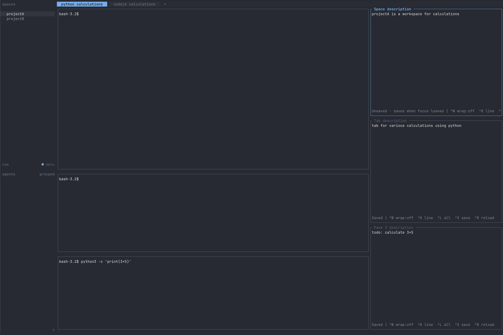

# herdr-description



Persistent descriptions for Herdr spaces, tabs, and panes. Requires Herdr 0.9.3+ and Python 3.9+ with `curses`. No third-party dependencies.

Descriptions open as stacked native panes in a full-height column on the right. Type in the editor; there are no Vim modes. Changes save on focus loss or `Ctrl+S`.

When regrouping an existing split layout, the plugin briefly moves panes through a temporary tab. Running terminals and editors, pane IDs, and split directions and proportions are preserved.

## Install

```sh
herdr plugin install ak-paca/herdr-description
```

Generate the keybinding block from the plugin directory:

```sh
python3 plugin.py keybindings
```

Paste the marked block into Herdr's `config.toml`, then:

```sh
herdr server reload-config
```

`prefix` is normally `Ctrl+B`. Actions are also in Herdr's action palette.

### From source (optional)

```sh
cd /path/to/herdr-description
herdr plugin link "$PWD"
herdr plugin enable herdr-description
```

## Editor

| Shortcut | Behavior |
|---|---|
| `Ctrl+S` | Save |
| `Ctrl+R` | Reload (confirms if dirty) |
| `Ctrl+K` | Delete current line |
| `Ctrl+L` | Clear all text (`Y` confirms) |
| `Ctrl+W` | Toggle word wrap |
| `Ctrl+X` | Remove this description, its file and mapping, and close its editor |

`Ctrl+X` acts on the description open in that editor, independently of the last focused work pane. It is disabled in the settings editor.

## Plugin commands

| Action | ID | Default |
|---|---|---|
| Create/edit tab | `edit-tab` | `prefix+alt+t` |
| Create/edit space | `edit-space` | `prefix+alt+s` |
| Create/edit pane | `edit-pane` | `prefix+alt+p` |
| Toggle description indicators | `toggle-indicators` | `prefix+alt+i` |
| Remove space | `remove-space` | `prefix+alt+shift+s` |
| Remove tab | `remove-tab` | `prefix+alt+shift+t` |
| Remove pane | `remove-pane` | `prefix+alt+shift+p` |

Change bindings in the plugin `hotkeys` config, regenerate the block, and reload. See [config.example.json](config.example.json).

## FAQ

**Where are config and description files?**

```sh
herdr plugin config-dir herdr-description
python3 plugin.py paths
```

For custom locations, pass `--config-dir` and `--state-dir` to `plugin.py`.

**How do I open settings?**

```sh
herdr plugin action invoke herdr-description.settings
```

`panel_width_percent` defaults to `30` (15–60). `hotkeys` maps action IDs to chords.

**How do I restore, restart, or export?**

```sh
herdr plugin action invoke herdr-description.restore
herdr plugin action invoke herdr-description.restart-editors
python3 plugin.py export > descriptions-export.json
herdr plugin log list --plugin herdr-description
```

Pass `--session <name>` to `herdr` for a named session. Use `restore` to repair a partial-height description column. If a layout operation is interrupted, its recovery plan is retained and running terminals stay open; `restore` retries the operation.

**How do I disable or uninstall?**

Toggle description indicators off first if they are enabled, so name markers are removed.

```sh
herdr plugin disable herdr-description
herdr plugin uninstall herdr-description
herdr plugin unlink herdr-description
```

Remove the marked keybinding block from `config.toml` and run `herdr server reload-config`.

**How do I run tests?**

```sh
PYTHONDONTWRITEBYTECODE=1 python3 -m unittest discover -s tests -v
```

Reference: [plugins](https://herdr.dev/docs/plugins/), [configuration](https://herdr.dev/docs/configuration/), [Herdr 0.9.3](https://github.com/herdrdev/herdr/tree/v0.9.3).
